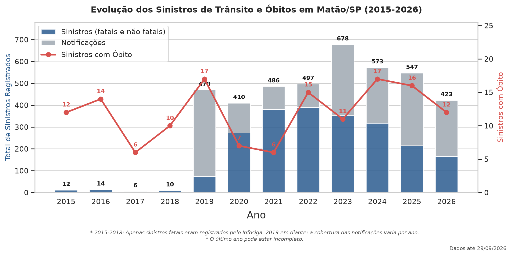
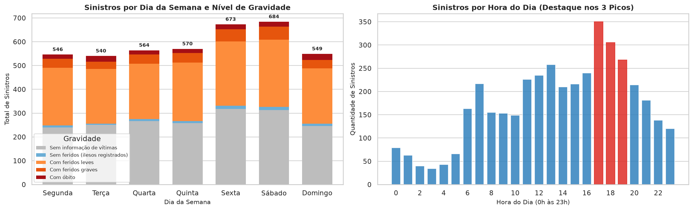
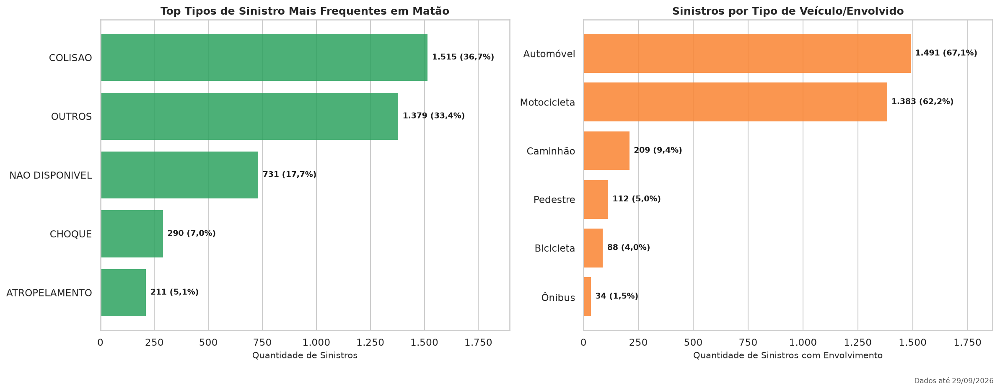
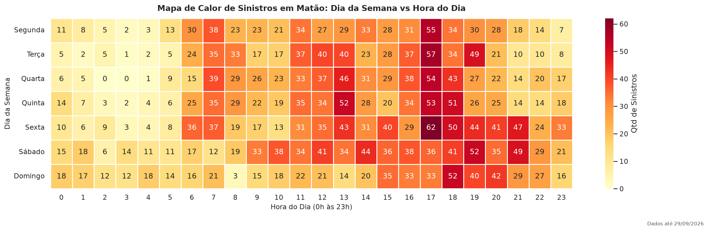
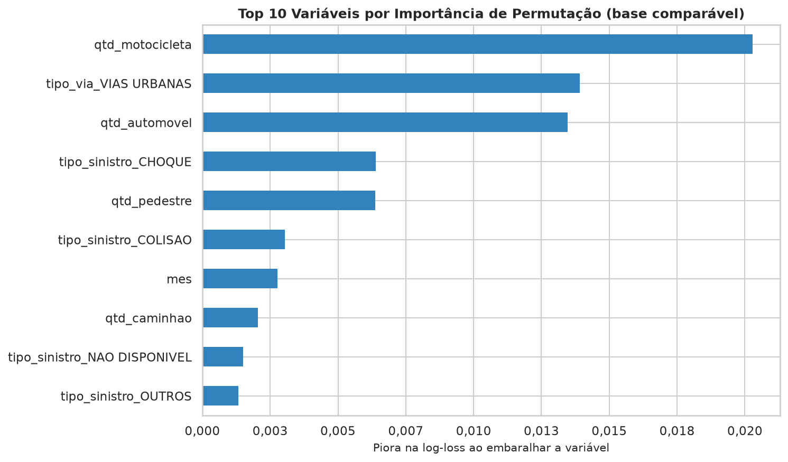

<!-- Gerado por scripts/gerar_artefatos.py. Para mudar o texto, edite templates/README.md.j2. -->
# 🚦 Análise e Diagnóstico de Acidentes de Trânsito em Matão/SP (2015–2026)

[](https://www.python.org/)
[](https://pandas.pydata.org/)
[](https://scikit-learn.org/)
[](https://plotly.com/)

Estudo de Ciência de Dados sobre os sinistros de trânsito registrados em **Matão/SP** desde março de 2015, com ingestão de dados estaduais, análise estatística, dashboard e mapa interativo.

> **Atualização automática:** este README, o relatório, a apresentação, o resumo em PDF, os gráficos e os mapas são gerados de novo quando chegam dados mensais. Gráficos, mapas, resumo em PDF e notebooks executados ficam na branch [`artefatos`](https://github.com/douglasagalbiatti/projeto-transito-matao/tree/artefatos), que guarda apenas a versão mais recente. O `Relatorio_Sinistros_Transito_Matao_2015-2026-1.pdf` é um registro histórico e mantém os textos anteriores; veja a [errata](output/relatorios/ERRATA.md).

---

## 📌 Sumário Executivo

Números do recorte até 29/09/2026:

- **Fonte de Dados:** Infosiga SP.
- **Volume:** **4.126 registros** (`cod_ibge == 3529302`), dos quais 1.916 são notificações, quase sempre sem dados de vítimas e veículos.
- **Base comparável:** letalidade, gravidade por modal e modelo usam sinistros de 2019 em diante, sem notificações.
- **Óbitos:** **150 vítimas** em 143 sinistros; 55% nas vias urbanas e 41% nas estradas e rodovias, com letalidade por registro de 2,2% e 14,7%.
- **Choque e colisão:** a letalidade do choque é 4,29 vezes a da colisão (IC95% 2,73 a 6,74), diferença que ocorre nas vias urbanas e não nas rodovias.
- **Dias:** 1,42 registros/dia nos dias úteis e 1,51 nos fins de semana (p = 0,107), com Sexta e Sábado nas maiores médias.
- **Modelo:** o Random Forest obteve 78,8% de acurácia, contra 78,8% de sempre prever a classe mais comum.

---

## 📂 Estrutura do Projeto

```text
projeto-transito-matao/
│
├── app.py                             # Dashboard Streamlit
├── data/
│   └── matao_limpo.csv                # Dataset tratado consolidado
├── notebooks/
│   ├── 01-exploracao.ipynb            # Leitura diagnóstica e auditoria de nulos
│   ├── 02-limpeza.ipynb               # Unificação, tipos e feature engineering
│   ├── 03-analise-matao.ipynb         # Análise temporal, modais, teste e modelo
│   └── 04-visualizacoes.ipynb         # Mapas e ranking de vias
├── output/
│   ├── graficos/                      # Figuras e mapa HTML (na branch artefatos)
│   ├── notebooks/                     # Notebooks executados (na branch artefatos)
│   └── relatorios/                    # Relatório, errata e resumo anual
├── scripts/
│   ├── atualizar_dados_infosiga.py    # ETL mensal
│   ├── gerar_artefatos.py             # Gera gráficos e documentos
│   └── publicar_artefatos.sh          # Substitui a branch artefatos
├── src/
│   ├── indicadores.py                 # Números usados nos documentos
│   ├── metricas.py                    # Regras estatísticas compartilhadas
│   └── modelo.py                      # Modelo exploratório
├── templates/                         # Modelos do README e dos documentos
├── tests/
├── requirements.txt
└── requirements-artefatos.txt         # Dependências da geração de artefatos
```

---

## 📊 Principais Resultados

### 1. Evolução Anual
Até 2018, a base traz apenas sinistros fatais. A partir de 2019, a participação das notificações varia de 21% a 84%, então o total anual não mede tendência. Os sinistros com óbito variam de 6 a 17 por ano, e as vítimas fatais, de 6 a 18.



### 2. Horários e Dias da Semana
Os maiores volumes ocorrem às 17h, 18h e 19h, sem dado de fluxo de veículos que permita medir risco. O teste de Welch com todos os dias do calendário não demonstra diferença entre dias úteis e fins de semana, o que não prova igualdade.



### 3. Letalidade por Tipo de Sinistro (base comparável)



| Tipo de Sinistro | Sinistros | Com óbito | Óbitos (pessoas) | Feridos graves (pessoas) | Letalidade |
| :--- | :---: | :---: | :---: | :---: | :---: |
| **Atropelamento** | 92 | 14 | 14 | 24 | **15,22%** |
| **Choque** | 267 | 32 | 33 | 36 | **11,99%** |
| **Outros** | 371 | 17 | 18 | 47 | **4,58%** |
| **Colisão** | 1.360 | 38 | 40 | 182 | **2,79%** |
| **Não disponível** | 78 | 0 | 0 | 5 | **0,00%** |

### 4. Dia da Semana e Hora do Dia



### 5. Modelo Random Forest
O modelo não supera a referência de sempre prever a classe mais comum, portanto não sustenta previsão de gravidade. A importância de permutação não indica sentido nem causa.



### 6. Mapas
O [mapa interativo](https://github.com/douglasagalbiatti/projeto-transito-matao/blob/artefatos/output/graficos/mapa_acidentes.html) (baixe o HTML para abrir) e o mapa estático mostram 2.159 registros, sem notificações, que se concentram em poucas coordenadas repetidas. Parte dos pontos restantes também pode indicar uma referência, e não o local do impacto.

---

## 🛠️ Como Reproduzir

```bash
git clone https://github.com/douglasagalbiatti/projeto-transito-matao.git
cd projeto-transito-matao

python -m venv .venv
source .venv/bin/activate  # No Windows: .venv\Scripts\activate
pip install -r requirements.txt
```

Os notebooks 03 e 04 rodam com a base versionada. Os notebooks 01 e 02 exigem os arquivos estaduais `data/sinistros_2015-2021.csv`, `data/sinistros_2022-2024.csv` e `data/sinistros_2025-2026.csv`, que não são versionados.

Para rodar o dashboard e os testes:

```bash
streamlit run app.py
```

```bash
python -m unittest discover -s tests -t .
```

Para gerar novamente gráficos e documentos:

```bash
pip install -r requirements-artefatos.txt
python scripts/gerar_artefatos.py
```

Altere textos em `templates/`, pois os documentos gerados são sobrescritos a cada atualização.

---

## 📄 Relatório Técnico
👉 [`output/relatorios/relatorio_final_matao.md`](output/relatorios/relatorio_final_matao.md)
